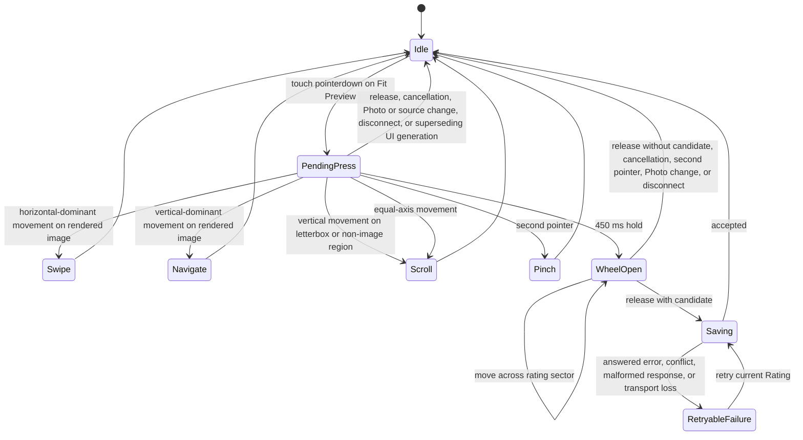

# Library Browsing and Selection

The Library Browser provides progressively loaded Grid and Photo views for `All Photos`, Original Folders, and Albums. [CONTEXT.md](../../CONTEXT.md#browsing-and-selection) defines the shared browsing and decision terms.

## Library Browser

The Library Browser is Slipstream's primary screen.

A bare application address MUST open directly to the `All Photos` Grid rather than an Album landing page.

Addressed entry follows [Library Browser Experience](experience/spec.md#destinations-and-browser-history).

Source navigation MUST show:

- the Photo Library as the `All Photos` source;
- the read-only Library Folder root and its Original Folders under a `Folders` section;
- each Album under a separate `Albums` section;
- the Photo count for each displayed source;
- current Library loading or scan status; and
- whether an Album has a saved position.

The `Folders` section presents the File Locations source defined by [Physical File Locations and Virtual Albums](../photo-library/design.md).

The bounded File Location windows and their design contract keep that name.

The active Grid status and every source card MUST use `1 Photo` for one and `N Photos` for every other count in both visible and accessible text.

Source layout, its narrow-screen disclosure, and focus restoration follow [Library Browser Experience](experience/spec.md#screen-structure).

Both layouts MUST preserve the `Folders` and `Albums` distinction.

A Folder and Album with the same name MUST remain distinguishable by section and source labeling.

Changing source MUST NOT require entering a separate workflow.

Expanding a Folder MUST show loading immediately when its children are not retained. Repeated expansion while that request is pending MUST join the same work.

A retained child window from the current File Location publication MUST reopen immediately, preserving its page without another request. Collapsed windows MAY remain in the bounded navigation cache; publication reset MUST discard them.

Reopening retained content MUST NOT clear an unresolved Folder failure or replace an explicit refresh or retry.

Explicit Folder count refresh MUST prevent older requests from restoring stale counts, including requests whose children have not appeared yet. It MUST preserve the latest requested page for visible Folders.

A response that arrives after a Folder is collapsed MUST NOT reopen it.

Folder Retry MUST retain keyboard focus while pending and expose progress even when its Folder is hidden. Repeated activation of the same pending Retry MUST join that work.

Successful Retry MUST move focus to an appropriate visible Folder control when the retry control disappears.

An expanded Folder MUST remain collapsible while its request is pending. Loading feedback MUST fit the Sources surface even for long unbroken Folder names, while retaining the complete accessible name.

On a wide viewport, the Photographer MUST be able to resize source navigation within a bounded width range.

The separator control MUST support pointer drag and focused Left and Right Arrow keys.

The separator MUST expose an accessible name, its current width, and its minimum and maximum bounds programmatically.


A keyboard resize MUST announce the resulting width.

A narrow viewport MUST NOT offer the separator and MUST keep the source navigation behind the Sources disclosure.

The current source MUST be visually and programmatically identifiable.

Source state MUST NOT depend on color alone.

A source name that is visually truncated MUST expose its complete name on hover.

An Original Folder with no descendant Folders MUST NOT present an expand control; affected rows MUST keep their alignment without it.

Opening Slipstream MUST NOT require the browser to download every Photo fact, every Album member, or the complete Original Folder tree.

Album summaries MAY arrive with the bounded Library Overview.

The `Folders` section MUST show a root labeled `Library Folder` without exposing its absolute server path, then load descendants as bounded direct-child Folder windows.

A Folder window MUST report its real parent, range, direct-child count, and recursive Photo counts without returning complete recursive membership.

All Folder windows retained together MUST come from the same Published Library.

Library summary counts and Albums MUST also be revalidated against that publication before they replace visible shared facts.

If a rescan replaces the publication while an older summary or File Locations are loading, Slipstream MUST discard the older summary and refresh File Locations rather than append or present facts from different publications.

Opening a Folder from an expired publication MUST refresh navigation and require the Photographer to open the current Folder projection; it MUST NOT silently reinterpret the stale Location against a different publication.

The two views are [Grid View and Photo View](../../CONTEXT.md#browsing-and-selection).

The Photographer opens Photo View by activating a Grid cell.

A Grid cell MUST be enabled only while its activation can immediately open Photo View against the current source.

While Slipstream replaces an expired source snapshot, it MUST make retained Grid cells unavailable until the replacement source is ready.

It MUST NOT expose an enabled Grid cell whose activation does nothing.

Photo View MUST provide a direct return to Grid View.

Returning to Grid View MUST restore the browser-local scroll position and current Photo when those cells remain in the open source.

Keyboard focus MUST return to that Photo cell when it is rendered, or to the Grid viewport when it is not.

Slipstream follows this familiar Library-browser shape without adding editing panels, Folder mutation, Album Groups, Smart Albums, keywording, or publishing to the browser.

The separate [Photo Development](../photo-development/spec.md) workspace and [Headless darktable Editing](../photo-development/darktable/editing.md) own image editing and its shared saved state.

## Presentation and Control Hierarchy

[Library Browser Experience](experience/spec.md) owns responsive screen composition, control placement, modal behavior, space budgets, and browser navigation.

The action semantics below apply regardless of where a control is presented.

Clear flag is unavailable while the current Photo is already `unflagged`.

Undo is unavailable until the current source has an undoable Selection State or Rating change.

## Mobile Photo View Quick Actions

The Quick Action Dock and Photo tools follow [Library Browser Experience](experience/spec.md#photo-view).

The [Rating Wheel](#rating-wheel) is an optional touch accelerator for the existing Rating action.

## Source Order

Source order and Capture Time inspection follow [Capture-Time Library Ordering](../photo-library/ordering.md#order-ownership).

An open source retains its ordered Photo IDs while a rescan refreshes facts; reopening or refreshing MAY use the new publication.

## Source Ordering Selection

Grid View MUST expose one explicit order selection for the open source:

- `All Photos` and an Original Folder offer Capture Time, earliest first
  (the default) and Capture Time, latest first.
- An Album offers Album order (the default), Capture Time earliest first, and
  Capture Time latest first.

A time order belongs to the open view only.

It MUST never rewrite persisted Album member positions, and an Album's persisted order remains the default when opened without an addressed order.

The server applies the selected order to the complete source before it paginates windows, so Grid and Photo navigation share one globally ordered view.

Photos without a valid authoritative Capture Time sort last in both directions.

Equal Capture Times keep the deterministic ordering Location and Photo ID tie-breakers; reversing the time direction never reverses those tie-breakers and never moves missing-time Photos ahead of timed Photos.

Time ordering uses the Photo's own Capture Time authority and camera-local normalization; it does not guess time zones and does not use file modification time.

Changing the order MUST keep the current Photo, resolved by Photo ID, and reposition the view around it.

Opening or reopening a different source uses that source's default order unless an addressed destination specifies another order.

Committed order survives reload through the destination URL under [Browser History](experience/spec.md#destinations-and-browser-history).

Album saved positions restore by Photo identity and are unaffected by the selected view order.

## Random Photo

Photographers sometimes want an unexpected Photo from the work they are already viewing without choosing a position manually.

Grid View MUST provide an explicit **Open a random Photo** action when the current view is ready and contains at least one Photo.

The action is read or navigate behavior: it MUST NOT record a Photo decision.

The action MUST sample from the complete ordered sequence of the current view:

- its source is the current `All Photos`, Original Folder, or Album;
- its order is the committed order of that open view; and
- its filter is the committed filter of that open view.

Every position in that sequence MUST have the same chance of being chosen.

The action MUST NOT sample only rendered cells, loaded windows, Photos with ready Previews, or available Originals.

An unavailable Original or unavailable Preview remains eligible when its Photo is in the sequence.

A result MAY be chosen again on a later activation; Slipstream MUST NOT maintain a hidden no-repeat list or a session random history.

When the sequence is empty, the action MUST NOT start.

The interface MUST distinguish an empty source from a source whose committed filter has no matches.

A random activation MUST use the current Snapshot's bounded position or window behavior and MUST NOT transfer the complete source to the browser.

While a random Photo is being resolved, the current Grid remains visible, the action admits at most one pending attempt, and repeated activation is unavailable.

Slipstream MUST NOT commit a Photo destination or claim that a Photo opened before the target's bounded Photo facts are ready.

Once those facts are ready, it opens the target through the ordinary Photo View path; Preview bytes MAY load under the existing Photo View rules.

The successful destination is an ordinary Photo destination containing the current source, order, committed filter, and target Photo identity.

It MUST NOT contain a random flag or seed.

Browser Back returns to the Grid context that started the action, with its existing source, order, filter, and Grid restoration rules.

Reloading the committed address opens that Photo and MUST NOT perform a new random draw.

An expired Snapshot, failed bounded read, or lost connection MUST leave the Grid context intact and expose the applicable Retry or Refresh Current Source path.

Slipstream MUST NOT silently replace the Snapshot, choose from a different source, show a different Photo as success, or create a Photo history entry for an unresolved attempt.

Opening a random Photo MUST NOT change Selection State, Rating, Album membership, Undo, an Original File, or any other Photo fact.

When the target belongs to an Album, becoming current in Photo View follows the existing Album saved-position contract; returning to a Grid does not write a saved position.

Photo View does not expose a separate random action in the first product; Previous, Next, and the existing review actions remain its continuous-review controls.

## Progressive Grid Loading

Grid View MUST become interactive from a bounded first window of Photos.

It MUST NOT wait for the entire source to transfer, parse, or render.

While a window loads, Grid View MUST show stable placeholders and a truthful status such as:

```text literal
Loading Photos 1–60 of 36,997…
```

As the Photographer scrolls, Slipstream loads bounded later windows.

The browser MUST keep the number of retained Photo facts and rendered Grid cells bounded independently of total Library size.

Range admission, bounded retention, and rendering ownership follow [Grid Loading](design.md#grid-loading).

A Grid cell MUST show, when available:

- a cached or progressively generated thumbnail;
- the Original filename;
- Selection State;
- Rating;
- Photo and Original unavailability as distinct facts;
- Preview unavailability or failure without removing the Photo from its position;
- Thumbnail unavailability or failure without changing a known Review Preview fact; and
- thumbnail delivery failure without replacing the Photo, Preview, or Thumbnail facts above.

When a Photo's Preview is already known to be unavailable, the Grid MUST NOT request its thumbnail or report a thumbnail delivery failure for that Photo.

A thumbnail delivery failure applies only when an otherwise available Preview could not be transferred or displayed.

A failed Preview MUST remain distinct from a failed transfer.

A Thumbnail request MAY fail while the Photo's Review Preview is ready.

Its result MUST remain a Thumbnail fact; a later Review Preview recovery MUST allow the Grid to retry that Thumbnail.

The Original filename is the basename of the Photo's ordering Original Location defined under Source Order.

A Grid cell MUST keep the position number visible and MUST truncate a long filename instead of breaking the cell layout.

A Grid cell MUST carry a Selection State badge only while that Photo is `picked` or `rejected`.

An `unflagged` Photo MUST show no badge, so the badge always marks a recorded decision.

Thumbnail completion MUST NOT change source order, Selection State, Rating, or saved Album position.

## Grid Composition and Orientation

Grid cells remain uniform, virtualizable units.

The Photo image MUST display complete and unstretched at its true aspect ratio:

- Landscape Photos render wider than tall.
- Portrait Photos render taller than wide.
- Square Photos render square.

A panoramic Photo MUST read as one long composition rather than a cropped strip.

Letterboxing MUST stay quiet.

A cell MUST NOT crop every Photo to one composition and MUST NOT stretch an image to fill its area.

Selection State, Rating, and Photo state indicators MUST NOT overlay the Photo image; they render beside or beneath the image area.

Orientation follows the EXIF-corrected derivative dimensions.

A Photo whose Preview derivative applies an EXIF rotation MUST display with the corrected orientation exactly once.

Each Photo has one Grid cell.

While a thumbnail is not yet loaded or its dimensions are unknown, the cell MUST keep a stable placeholder.

The placeholder MUST NOT fake an orientation and MUST NOT cause Grid layout to jump when the thumbnail arrives.

Thumbnail, Preview, scan, and bounded look-ahead loading MUST run in the background.

Rebuildable or superseded loading MUST NOT delay source changes, navigation, already available controls, or returning between Grid View and Photo View.

Changing source or view MUST cancel pending image transfers and requests owned only by the previous source, Photo, or view; hiding obsolete loading is not sufficient when it would continue consuming capacity.

Slipstream MAY wait only when the requested action depends on confirmed facts or persistence, such as opening a source's first bounded window or safely completing a Selection State change before advancing.

## Grid Thumbnail Size

The Photographer judges focus and expression from the thumbnails themselves, and one fixed thumbnail size forces a choice between seeing too few Photos and seeing them too small.

Grid View MUST therefore offer Small, Medium, and Large thumbnail sizes, and a newly loaded Library Browser starts at Medium.

The size is a presentation option of the open Grid.

It MUST NOT create a source, and it MUST NOT change source order, Album membership, Selection State, Rating, saved Album position, or Original Files.

The chosen size applies while the Library Browser stays open: opening another source keeps it, and a browser reload starts again at Medium.

Changing the size MUST keep the Photographer's place: the topmost visible row of Photos stays the first visible row, and the Grid then loads the bounded windows of the new layout exactly as scrolling does.

Every size keeps the cell rules of Grid Composition and Orientation and the bounded rendering and loading rules of Progressive Grid Loading.

The size control MUST be operable from a keyboard.

Grid keys act only while the Grid owns keyboard focus, so the control receives its own keys unchanged.

## Photo View

Photo View MUST show one current Photo as the primary content.

It MUST make the following facts and actions available, with their primary or disclosed placement defined by [Library Browser Experience](experience/spec.md#photo-view):

- current position and total Photo count;
- the Original filename when available;
- Selection State;
- Rating;
- Preview Source;
- the Albums that contain the current Photo;
- controls for pick, reject, clear flag, undo, and Rating;
- previous and next navigation;
- whether Preview detail is limited; and
- review-relevant capture metadata when available: Capture Time, Aperture,
  ISO, Shutter Speed, and Focal Length.

Capture metadata is read-only.

A missing or unreadable field MUST display an explicit `—` value.

The displayed values come from the Photo's own Original File.

Metadata loading failure MUST NOT disable selection, Rating, navigation, or Preview behavior.

Slipstream does not provide a general EXIF editor or an unbounded metadata browser.

Capture Time MUST display as camera-local `YYYY-MM-DD HH:MM`.

Sub-second precision and the timezone-free normalized form are transport detail and MUST NOT appear in the interface.

Slipstream MUST NOT convert, re-interpret, or invent a timezone for this value.

Photo View MUST present one combined Preview detail statement beside the Preview Source fact.

It MUST report:

- the Preview's actual dimensions;
- its stable source Preview Capability; and
- when displayed scale enlarges Preview pixels, that enlargement cannot add source detail.

The complete explanation MUST be available in the accessibility tree.

It MUST NOT rely on a title tooltip, hover, color, or animation.

The statement MUST be recomputed on:

- Preview load;
- Photo View resize;
- Fit recomputation;
- manual zoom;
- wheel zoom;
- pinch zoom; and
- return to Fit.

Recomputing it MUST change no Photo fact, Selection State, Rating, Album membership, saved position, history, or Undo.

Limited Preview detail MUST NOT be presented as a separate fact row.

The next and previous Photos MUST remain reachable without recording a decision.

Photo View MUST provide the current Photo's immediate neighbors as a bounded strip of thumbnails centered on the current Photo.

Its wide and compact placement follows [Library Browser Experience](experience/spec.md#photo-view).

Activating an entry navigates to that Photo, and the entry for the current Photo is marked as current and presents no activation.

The strip is bounded independently of source size and follows the open source's order, so an Album's explicit order and a Selection State filter show the neighbors the Photographer actually moves through.

The strip is supporting content.

On a short viewport it yields so the Preview, the decisions, and Rating keep their space, and it MUST never widen Photo View or clip a control.

A neighbor the browser has not loaded MUST appear as an unavailable entry rather than a guessed Photo.

Moving through the strip is navigation: it MUST NOT record a decision, and it MUST NOT replace the Previous and Next controls.

Every entry MUST be reachable and operable with the keyboard, and the strip MUST NOT take over a Photo View shortcut.

Slipstream MUST prioritize the current Photo's Preview.

After the current Preview is ready, it MAY prepare the immediately next and previous Previews in the background.

This preparation MUST NOT change saved position or selection state.

Photo View MUST keep the Preview inside the available viewport width and MUST never create horizontal overflow.

Photo View MUST keep the primary review controls reachable without scrolling away from the Preview at 375 by 667, 390 by 844, and the named short-landscape viewports.

These primary review controls are the context row, one Previous/position/Next navigation group, and the review dock's Reject, Rating, Pick, Undo, and More actions.

Vertical scrolling remains available only for supporting content or for enlarged text.

The Preview region reserved at 390 by 844 MUST stay at 650 pixels and MUST NOT push the primary review controls below the safe viewport.

## Loading Feedback

Slipstream MUST distinguish these user-visible states:

- connecting to the server;
- loading the Library summary;
- preparing the current source order;
- loading a bounded Grid or Photo window;
- preparing a thumbnail or review Preview;
- scanning the Library Folder;
- recovering relocated Original Files;
- enrolling content fingerprints; and
- disconnected or failed.

Slipstream MUST show a numeric count or percentage only when it knows the corresponding total and completed amount.

Otherwise it MUST show the current phase without inventing progress.

An existing published Library MUST remain browsable while an ordinary background rescan checks for changes.

The interface MUST show the current scan phase and real counts when available.

If the check fails, Slipstream MUST retain the prior Published Library and offer **Retry Library Check**.

When a replacement publishes, a completion notice MUST offer **Refresh Current Source**.

Shared counts and the `Folders` section MAY refresh immediately when a replacement publishes.

Photos discovered by that scan appear in the open source only after refresh or reopen; they MUST NOT move the open view.

On a new state store with no published Library, the browser MAY show initialization progress until the first scan publishes the Library.

## Recovery Review

A rescan that relocates or still misses Original Files MUST report committed recovery counts on the Library status, for example `Updated locations for 126 photos. 3 originals still unavailable.`

The unavailable count includes only Photos that are not Removed and whose Originals are unavailable.

A successful recovery MUST stay unobtrusive: it MUST NOT open a dialog or require a path entry.

A candidate match, an occupied destination, or an unresolved proposal MUST NOT be counted as a committed recovery.

The status MUST NOT imply that Original bytes were copied or restored.

Slipstream MUST offer one bounded `Review unavailable Originals` entry from the scan result and from an affected Photo.

The review opens on the bounded unavailable inventory.

Mapping configuration is entered from a named inventory item or from an explicit mapping action; no empty mapping form precedes the inventory.

The entry MUST list remembered Locations, filenames, kinds, Ratings, Selection States, Album counts, and whether each Original has a fingerprint.

It MUST let the Photographer propose mappings, inspect every proposal, and confirm an explicit apply under the [Photo Library and Albums](../photo-library/spec.md) manual recovery rules.

The Web review presents three simple outcomes: updated automatically, ready for confirmation, or still unavailable.

A confirmation item shows the remembered and proposed Locations, file kind, and its evidence state.

The Photographer MAY confirm one item or an explicitly selected bounded set; protocol identifiers and revision facts remain behind details rather than primary controls.

An occupied destination is never silently merged.

When a permitted Retire and Bind action is available, the review names the record that would be retired and uses a plain-language confirmation; otherwise it offers review later.

If an apply response is uncertain, the review says so, offers current-state inspection, and does not automatically retry or report completion.

Unavailable Photos MUST stay in their Grid positions and Albums with their remembered facts.

Slipstream MUST NOT remove a Photo or its decisions only because its Original File is missing.

The review MUST keep active unavailable Photos separate from Removed Photos in Trash.

It MUST NOT offer Location Recovery for a Removed Photo; restoring its Library record uses the Trash Restore contract and does not recreate missing file bytes.

Slipstream MUST show one primary actionable failure for an affected Photo.

It MUST distinguish not found, unreadable, Preview failure, request failure, and disconnection.

Once Original unavailability is established, it MUST suppress a redundant thumbnail-delivery error for that Photo.

## Empty Sources

An empty source MUST identify what is empty and MUST NOT imply that Photos or Original Files were removed.

When the Photo Library contains no Photos, the `All Photos` source and Library Folder source MUST say that no supported Photos were found.

They MUST direct the operator to check the configured Library Folder or add supported files, then offer **Check Library** through the existing rescan workflow.

A completed check follows the normal **Refresh Current Source** contract above.

An empty Album MUST remain openable and manageable. Its Grid MUST identify the empty Album and offer **Browse All Photos**, an ordinary navigation to that source's default Grid.

The empty Grid MUST explain how to add Photos through Photo View membership or Grid multi-selection. **Browse All Photos** neither enrolls Photos nor creates an implicit collection mode.

Rename and delete remain available through source navigation.

## Saved Position

Slipstream MUST remember the last Photo shown in Photo View for each Album.

Grid scrolling alone does not change durable saved position.

Opening the Album's Grid MUST expose Resume when a saved position exists.

Resume MUST return to the saved Photo when it remains a member and its Original is available.

An explicit Photo address takes precedence over that saved position.

Source navigation and Resume history follow [Library Browser Experience](experience/spec.md#destinations-and-browser-history).

If the saved Photo remains an Album member but its Original is unavailable, Slipstream MUST move to the next member with an available Original by membership position and wrap once.

If no member has an available Original, Slipstream MUST keep the saved member current.

Removing the saved Photo from the Album clears that Album's saved position and removes its Resume availability.

Opening the Album still shows its Grid; opening a Photo from that Grid establishes a new saved position.

The first product does not persist a durable `All Photos` or Original Folder resume position.

Their addressed Photo and browser-local Grid restoration follow [Returning to a Grid](experience/spec.md#returning-to-a-grid).

## Album Management

The Photographer MUST be able to create an Album from source navigation.

Album names follow the [Album naming boundary](../photo-library/design.md#album-mutations): they MUST be nonempty, at most 120 characters, and unique under SQLite's ASCII-only NOCASE collation. Scripts without letter case, such as Chinese, are unaffected.

Creation from Sources opens the new empty Album's usable Grid with rename and delete controls. Contextual creation follows the return behavior below instead of navigating to that Grid.

Photo membership management and the Grid Add to Album chooser MUST also offer **New Album**, including when no Albums exist. They reuse the same creation form and name validation.

Opening contextual creation replaces the current supporting content, not the underlying source or Photo. It MUST NOT stack a second modal.

Contextual creation creates only the Album. Confirmed success MUST return to the initiating membership panel or batch chooser with the new Album available and identified, retaining the Photo or selected IDs.

Contextual creation MUST NOT implicitly add members or switch to the new Album. The Photographer then checks membership for the current Photo or explicitly confirms the batch addition.

Creation and membership addition are separate persisted actions. A failed membership addition leaves the created Album available and reports that addition's failure, not a failed creation.

Cancelling the creation form returns to its parent without changing membership or clearing the existing selection.

An unknown creation outcome requires inspection of the Album list before another create. A matching name alone is not proof of which attempt created it.

Dismissing the workflow or changing source or Photo detaches its return behavior. An admitted create still settles, but its completion MUST NOT reopen the panel, restore an obsolete selection, or start membership work.

Opening Album creation or rename MUST focus the Album name input and select its current value.

Closing an Album form after cancellation or a completed action MUST return focus to the control that opened it when that control remains available, or to the nearest stable Album action.

A validation or persistence failure MUST keep the form and its input recoverable; closing that form follows the same focus rule.

The Photographer MUST be able to rename an Album and delete an Album after a confirmation that Photos and Original Files remain unchanged.

Deleting the open Album MUST return to `All Photos` or another valid source without leaving an unusable current source.

Photo View MUST let the Photographer add the current Photo to one or more Albums.

Adding a Photo that already belongs to an Album MUST NOT create a duplicate membership.

When the current source is an Album, Photo View MUST let the Photographer remove the current Photo from that Album.

When the current source is an Original Folder, View options MUST offer one explicit **Add Folder** action.

The Photographer chooses an Album and confirms the action.

Slipstream adds every Photo in that Folder and its descendants in the same order as the open Folder source.

The action follows the bounded [Folder-to-Album Add](../photo-library/design.md#folder-to-album-add) contract.

The action is one bounded, idempotent operation.

A Photo already in the Album is skipped without changing its membership position.

The response MUST report the matched, added, and already-member counts.

While it is running, the action is disabled and reports that the Folder is being added.

A failed or expired operation MUST remain visibly incomplete and MAY be retried after the current Folder source is refreshed.

A Folder with more than the server's bounded operation limit is rejected before any membership is committed.

A confirmed membership addition appends the Photo after existing members.

Removing a Photo MUST compact later membership positions without changing their relative order.

Removing the saved or current Photo MUST apply the saved-position rules before the Album is next opened.

Album mutations MUST persist before Slipstream presents them as complete.

Changing source or Photo MUST NOT cancel an admitted persistence operation, but a late response from an obsolete UI generation MUST NOT overwrite the current source, current Photo, or current error state.

The first Album-management interface does not require drag-and-drop, a visual bulk reorder surface, Album covers, sharing, Album Groups, or Smart Albums.

Adding an entire current Folder and adding the Grid's multi-selection are supported separately from each other.

## Photo Album Membership

Photo View MUST show which Albums contain the current Photo.

The membership list is the server's answer for that Photo, not the browsing source or a recent management action.

The same Photo MUST show the same membership from any source and after reload.

A Photo in no Album MUST say so explicitly.

Membership loading and failure are displayed independently of the Preview and capture metadata.

A failed membership load MUST offer a retry that reloads only membership facts and MUST NOT disable selection, Rating, navigation, or Preview behavior.

Photo View MUST offer one membership management panel that lists Albums with a checkbox reflecting the Photo's true membership.

Checking an Album adds the Photo through the same persistence rules as any membership addition, and unchecking removes it through the same rules as membership removal, including the browsing-position contract when removing from the open Album.

Creating a new Album follows [contextual Album creation](#album-management), without implicitly checking membership.

An Album list too large for one view MUST load on demand rather than transferring every member of every Album.

A successful add or remove MUST update the membership list and the Album counts.

A failed toggle MUST keep the prior true state, identify the failed Album and action, and leave the toggle retryable.

Adding a Photo that already belongs MUST NOT create a duplicate membership.

Switching Photos quickly MUST never present another Photo's membership.

A membership response that arrives after its Photo is no longer current MUST be discarded.

## Selection State

[Selection State](../../CONTEXT.md#browsing-and-selection) is one Photo-wide decision.

Pick and Reject replace each other; clearing either returns the Photo to `unflagged`.

A review action MUST persist before Slipstream treats navigation caused by that action as safely completed.

The interface MAY animate immediately, but a persistence failure MUST restore or retain the prior visible state and keep the affected Photo recoverable.

## Selection Filter and Progress

A second reviewing pass works on one Selection State at a time: the Photographer re-checks rejects, then finishes the unflagged Photos.

Grid View MUST therefore offer an `All`, `Unflagged`, `Picked`, or `Rejected` view of the open source, and MUST show how much of that source is decided.

Grid View MAY combine the Selection State choice with the other defined filter conditions: Rating bounds, Original kind, Original availability, and a Capture Time range.

Their meaning and boundaries follow [Source-Scoped Library Filters](filters/spec.md#defined-conditions).

Conditions of different facts combine with AND.

The Photographer MUST be able to tell which non-default conditions are active.

The filter is a view option of the open source.

It MUST NOT create a source or an Album, and it MUST NOT change Album membership, Album member position, or Original Files.

The filter and the view order are independent: changing one keeps the other.

Committed filter values survive reload through the destination URL under [Browser History](experience/spec.md#destinations-and-browser-history).

The reported Photo count MUST describe the filtered view.

Filtering and pagination follow [Source-Scoped Library Filters](filters/spec.md#applying-and-reading-a-filter).

A filtered view pages and navigates like an unfiltered one: Previous and Next move through the filtered Photos only.

A filtered view that matches no Photos MUST report that no Photos match the filter; it MUST NOT report an empty source, offer a Library check, or show the previous filter's Photos.

A no-match result is not an empty Library.

Changing the filter reopens the same source in the new view.

When the current Photo matches the new filter, the reopened view keeps that Photo; otherwise it starts at its first Photo.

A rescan MUST NOT insert, remove, or reorder Photos in an open filtered view.

A decision that makes a Photo stop matching the open filter leaves that Photo visible until the source is reopened.

Grid View MUST show decision progress for the open source: the number of decided Photos against the source total, and the per-state counts.

The counts describe the source rather than the open filtered view, so they still answer how much review remains while the Photographer works inside one Selection State.

They come from the server's source facts; the loaded Grid window MUST NOT be their only source.

A confirmed decision and Undo update them without a reload, and reopening the source replaces them with the server's counts.

The filter control MUST be operable from a keyboard and MUST receive its own keys unchanged.

Grid decision and Rating keys MUST NOT act on the focused Photo while the filter control holds focus.

While a Library scan runs, the counts describe the open source's bounded published state.

They MUST NOT imply that the whole Library is decided or that the source is final.

## Touch Gestures

While the Preview zoom state is Fit:

- horizontal swipes are the optional decision accelerator: a committed right
  swipe sets `picked`, and a committed left swipe sets `rejected`;
- a committed decision advances to the next Photo only after the decision is
  accepted;
- a drag below the commit threshold returns the Photo to its starting position
  without changing any Photo fact; and
- the surface shows the candidate action before release only during an active directional gesture. On every pointer capability, including touch-only and hybrid devices, no direction labels remain at rest.

While the Preview zoom state is Fit, a committed upward swipe opens the next Photo and a committed downward swipe opens the previous Photo.

These are navigation accelerators only: they never change Selection State, Rating, Album membership, saved Album position, or Undo.

Direction feedback MUST name the mapped candidate action. Decision gestures use **Pick** or **Reject**; navigation gestures use **Next** or **Previous** without decision colors.

Direction feedback MUST clear on:

- release or below-threshold cancellation;
- pointer cancellation or lost capture;
- Photo or source change;
- leaving Fit;
- supporting-surface entry.

An admitted write or navigation uses its ordinary pending and outcome presentation. Gesture feedback MUST NOT imply that the operation has already succeeded.

A failed navigation retains the prior committed Photo and its retry target.

The explicit Previous and Next controls remain visible and equivalent, so no gesture is required for navigation.

The directional mapping is fixed across All Photos, Original Folders, Albums, and Selection State filters.

It MUST NOT reverse when source order or filter changes.

`Up` means next and `Down` means previous because the gesture follows the mobile-feed convention of continuing to the next item; the source's ordering semantics remain represented by the visible position and Previous/Next labels.

A horizontal or vertical gesture MUST NOT be interpreted as both a decision and navigation action.

The gesture owner is selected before commit from the dominant axis; equal-axis movement has no action.

On the rendered image, an uncommitted drag returns to its starting position without changing Photo facts.

The rendered image and its letterbox are separate touch regions.

In Fit, the rendered image admits the four directional accelerators; the letterbox and other non-image Preview regions retain native vertical scrolling.

A drag below the commit threshold returns the rendered image to its starting position without changing Photo facts.

A two-finger pinch always zooms the Preview, and a manual zoom state gives one-finger dragging to bounded panning instead of decisions or navigation.

A decision swipe and a navigation swipe MUST use visible directional feedback before release and MUST NOT depend on haptics or animation.

Rating uses the explicit controls required below and MAY use the touch-only [Rating Wheel](#rating-wheel).

Slipstream MUST provide visible controls equivalent to every gesture action.

Adding a second pointer starts Pinch Zoom without changing Rating.

### Rating Wheel

The Rating Wheel is an optional touch accelerator for the current Photo.

It is available only while the Preview is in Fit, the current Photo is connected and ready for decisions, and no other Photo mutation is settling.

A mouse pointer MUST NOT open it.

Grid View MUST NOT acquire a Rating Wheel or any other long-press action as part of this contract.

The touch ownership states are:



The touch owner follows the transitions above; cancellation MUST NOT change Photo facts.

The candidate uses these initial product thresholds:

- the pointer MUST remain within 12 CSS pixels of its starting point; and
- it MUST remain stable for 450 milliseconds.

The thresholds are interaction behavior, not a user setting.

A later device qualification MAY propose new thresholds only through a Product Spec change.

A pointer release before 450 milliseconds cancels the candidate without a mutation.

It leaves the existing double-tap detail-zoom behavior unchanged.

Before the 450-millisecond threshold, movement beyond 12 CSS pixels selects the larger absolute axis delta as the gesture owner.

When the threshold is reached, Slipstream opens a transient Rating Wheel near the starting point.

The Wheel MUST adapt inward when the starting point is near an edge or safe-area inset.

It MUST expose exactly six candidates: `0`, `1`, `2`, `3`, `4`, and `5`; `0` means No Rating.

The current Rating MUST be highlighted, and the candidate under the pointer MUST be communicated with its numeric and star meaning.

A candidate highlight is presentation only; it MUST NOT persist while the pointer remains down.

Moving between candidates MAY change the highlighted candidate any number of times, but it MUST never start a save.

Releasing on one candidate MUST emit exactly one Rating value for that gesture and enter Saving once; duplicate pointer-up or late events MUST NOT create another Rating mutation.


A committed Rating MUST:

- persist through the existing Photo Rating mutation;
- leave Selection State, Album membership, Photo position, and saved Album
  position unchanged; and
- keep the current Photo open without automatically advancing to the next
  Photo.

While the Wheel is pending or open, the Preview MUST suppress the browser's context menu for that gesture.

It MUST NOT suppress the browser context menu for an unrelated mouse interaction.

The Wheel MUST provide a programmatic name, current candidate, and instruction that the Photographer MUST release to save.

Existing visible Rating controls and keyboard shortcuts remain the accessible and non-gesture fallback.

On a persistence failure or uncertain transport result, Slipstream MUST close the Wheel, keep the previous Rating visible, identify that the change was not confirmed, and expose the existing retry and connection-recovery path.

The outcome rules are:

- an accepted response MAY update the current Rating only with the server's
  confirmed value;
- an answered error or conflict keeps the previous Rating, identifies that the
  Photo changed elsewhere or the action was rejected, and offers retry;
- a malformed, incomplete, or otherwise untrusted response moves no Rating,
  Selection State, Photo position, or Undo entry and offers retry; and
- transport loss leaves the admitted change retryable without claiming whether
  the server applied it, until the existing recovery path confirms the current
  Photo state.

If a newer Rating intent, Photo change, source change, disconnect, or teardown supersedes a save, the Photo owner MUST cancel or fence the older request.

A late result for an obsolete Photo or obsolete intent MUST NOT repaint the current Photo's Rating or status and MUST NOT create a second Undo entry.

Reduced-motion users MUST NOT need animation or haptic feedback to understand or complete the action.

## Preview Zoom and Fit

Photo View MUST keep the complete Preview visible by default.

**Fit** shows the entire Preview without cropping, as large as the available Preview area allows, and is the state every Photo opens in.

Photo View MUST expose explicit zoom controls:

- a **Fit Window** action that restores the complete composition;
- a zoom out action, a continuous zoom slider, and a zoom in action;
- a live zoom percentage; and
- a **100%** action.

The percentage is relative to the Preview image's own pixels.

`100%` maps one Preview pixel to one CSS pixel regardless of device pixel ratio; it reports the honest derivative resolution and never implies RAW sensor precision.

The zoom range is 10% to 800% of the Preview's natural size.

The buttons and wheel step zoom multiplicatively, and the slider moves continuously within the same range.

Fit is reported with the percentage it actually produces.

On a device with a pointer wheel, wheel zoom MUST keep the image point under the pointer stationary while zooming.

On a touch device, a two-finger pinch zooms around the gesture midpoint.

Once the Photo is larger than the Preview area, dragging pans within bounded overflow so the image cannot be dragged out of view; while it fits, panning is not available and the image stays centered.

Zoom and pan MUST never record a Selection State or Rating.

While the zoom state is manual, one-finger dragging pans the Preview and swipe decisions are unavailable; explicit Pick and Reject controls stay available.

In Fit, a horizontal-dominant drag on the rendered image is the decision gesture and a vertical-dominant drag is the navigation gesture; vertical movement in the letterbox or another non-image Preview region remains native Photo View scrolling.

Every zoom control MUST be operable from the keyboard, and the current zoom state MUST be exposed programmatically.

Keyboard shortcuts `+` and `-` step zoom, `F` restores Fit, and `D` toggles a 200% detail zoom.

Changing Photo or returning to Grid View MUST reset the zoom state to Fit.

When the viewport or Preview area changes size, Fit MUST recompute, and a manual zoom MUST keep its percentage while its pan is constrained again.

Zooming above 100% is allowed but is always reported truthfully; the interface MUST NOT suggest the source contains detail beyond the Preview derivative.

## Rating

A Photo has a Rating from zero through five stars.

Zero means no Rating.

Changing Rating MUST NOT change Selection State.

Picking or rejecting a Photo MUST NOT change Rating.

The Photographer MUST be able to set Rating through visible controls.

Keyboard Rating shortcuts follow [Keyboard Behavior](#keyboard-behavior) and [Grid View Keyboard](#grid-view-keyboard).

Exactly one visible Rating control from zero through five MUST communicate the current Rating visually and programmatically.

The mobile Rating entry and the explicit Rating path opened from it count as the same Rating control for this rule; the touch-only Rating Wheel is an accelerator and does not replace them.

Zero MUST remain an explicit current value when the Photo has no Rating.

Photo View MUST present a Photo with no Rating as `No Rating` in its Rating fact.

A rated Photo MUST present `<N> star` for one and `<N> stars` otherwise.

This wording applies to the fact only; the Rating control keeps zero as an explicit value.

## Undo

Slipstream MUST provide undo for the most recent Selection State or Rating change made since the Photographer opened the current source.

Undo MUST restore the previous value and return to the affected Photo when the original action advanced away from it.

The first product requires one-level undo.

Undo remains available until another Selection State or Rating change occurs, the Photographer changes source, or the browser reloads.

One batched Selection State change counts as one change for this rule.

The browser holds the one undo description; the server does not persist undo history.

The undo description MUST identify its affected Photo by stable Photo ID.

Any position retained with that description is only a hint for the current Browse Snapshot.

When the same source is reopened with a replacement Snapshot, Slipstream MUST resolve the Photo ID against that Snapshot before loading or applying Undo.

The resolution MUST use one bounded position lookup and MUST NOT transfer the complete source or create browser-global state.

If the affected Photo is no longer in the current source, Slipstream MUST clear the undo description and identify that Undo is no longer available.

If the bounded lookup fails, Slipstream MUST keep the undo description and current Photo unchanged, identify that the target could not be located, and allow the Photographer to retry.

It MUST NOT send the Undo mutation until the target identity and current position are confirmed.

Undo MUST fail without changing state when the Photo's current value no longer matches the value produced by the action being undone.

## Keyboard Behavior

On a device with a keyboard, Photo View provides:

- Right Arrow moves to the next Photo without changing it.
- Left Arrow moves to the previous Photo without changing it.
- `P` picks the current Photo.
- `X` rejects the current Photo.
- `U` clears the current Photo's Selection State.
- `0` through `5` set Rating.
- `Ctrl+Z` or `Command+Z` performs undo.

Keyboard actions MUST follow the same persistence and undo rules as visible controls and gestures.

## Grid View Keyboard

Grid View MUST be operable from a keyboard without opening Photo View.

- The Grid is entered once by Tab. The Grid viewport is its entry and fallback Tab stop; at most one rendered cell is a Tab stop at a time, namely the cell the keyboard owns.
- Arrow keys move cell focus. Left and Right move one Photo; Up and Down move one complete row.
- Moving cell focus MUST load the bounded window that contains the target row, exactly as scrolling does. Cell focus MUST NOT stop at the edge of a loaded window.
- While the focused Photo's bounded window is loading, the Grid keeps keyboard focus and returns it to the cell once that cell renders.
- The focused cell MUST keep its visible focus ring when a window replacement or a merged render rebuilds it.
- `Enter` opens the focused Photo in Photo View.
- `P`, `X`, `U`, and `0` through `5` apply to the focused Photo, with the same persistence and undo rules as their Photo View equivalents. A decision MUST NOT move cell focus, and `U` MUST perform no write while the focused Photo is already `unflagged`.
- A failed Grid decision MUST report on the Grid's status line and MUST keep the affected Photo recoverable. It MUST NOT open Photo View.
- Grid keys MUST act only while the Grid owns keyboard focus. Another surface with focus, such as an Album name input, MUST receive its own keys unchanged.

While the Grid is open, undo of a change that did not advance away from the affected Photo MUST restore the value in place, keep the Grid open, and return cell focus to the affected Photo.

Undo of a change that advanced away MUST return to the affected Photo in Photo View.

The browser holds one undo description, shared with Photo View.

## Grid Multi-Selection and Batch Actions

Culling one Photo at a time does not scale to a burst or a shoot.

Grid View MUST therefore let the Photographer mark several Photos and apply one decision or one Album addition to all of them.

Grid View supports multi-selection in addition to the single open target:

- a shift-click extends the multi-selection over the Photos between the last
  multi-selection anchor and the clicked Photo;
- a Control-click or Command-click toggles one Photo;
- an explicit **Select** mode makes every Grid cell activation toggle that
  Photo's multi-selection instead of opening Photo View, so a touch device can
  multi-select without a modifier key.

One batch addresses at most 100 Photos.

While **Select** mode is active, its header MUST show the count, including `0 / 100 selected`, and Done. The action tray appears only for a nonempty selection under the [experience contract](experience/spec.md).

The Grid refuses to grow the multi-selection past that bound, names the bound when it does, and keeps the selection it already holds, so a batch the server would refuse can never be built.

A refused toggle or range is one operation: the selection and its anchor do not change.

The Grid MUST say: `Selection limit reached. Remove a Photo to extend the range.`

The selection tray MUST state `Selection remains active` after a batch operation.

It MUST show the active source and MUST distinguish the visible filtered result count from the Selection State counts for the complete source.

The **Select** mode MUST be enterable and leavable from a keyboard.

Done and Escape from the Grid empty the multi-selection and leave **Select** mode, including at zero selected. While a supporting surface owns focus, Escape follows that surface's close or local form-return behavior instead.

Opening or reopening a source also leaves Select mode.

The Grid decision and Rating keys keep their existing meaning for the focused Photo.

A range extends over the Photos the Grid has loaded.

A position the Grid has not loaded cannot join the multi-selection, and the count reports the Photos that are actually selected.

While the multi-selection is not empty, the Grid MUST show its count and a clear exit that empties it and leaves **Select** mode.

It MUST also show the batch actions **Pick**, **Reject**, and **Add to Album**.

Multi-selection MUST read differently from the single open target and MUST NOT depend on color alone; a multi-selected Grid cell MUST expose that state to assistive technology.

Batch **Pick** and **Reject** apply one Selection State to every selected Photo through the same persistence rules as a single decision, as one bounded operation.

Each selected Photo carries the last Selection State the browser confirmed for it.

A Photo whose current Selection State differs from that expected value is reported as changed elsewhere and is not overwritten.

A Photo the current Library no longer holds is reported as missing and does not block the other Photos.

A confirmed Photo moves the decision progress once.

`Review N` also reconciles each refreshed Photo from the state contribution the source counts already held to the observed state, so a retry does not move its progress twice.

A batch carries no Album position write even in an open Album: it moves no browsing position.

A failed or partial operation MUST leave every affected Photo recoverable and MUST NOT present the batch as complete.

The Grid MUST report applied, changed-elsewhere, and missing Photos separately.

A changed-elsewhere Photo remains selected for review or retry.

The result MUST identify missing Photos as `no longer in this Library` and concurrent state differences as `changed elsewhere`.

It MUST offer `Review N` for the latter, where `N` is the number of affected Photos.

`Review N` focuses the affected cells and opens no modal.

Review MUST refresh each affected Photo's current facts before another decision can be confirmed.

Review verifies the Photo's position in the current Browse Snapshot before it reports the Photo as missing; local fact eviction stays retryable and is not proof of deletion.

A missing Photo remains visible in the selection result and the tray count until the Photographer clears it or opens another source, but it is marked `no longer in this Library` and is excluded from later batch requests.

It does not consume a retry or create a new decision count.

A batched Selection State change is one undoable change: Undo restores the prior Selection State of every Photo the batch confirmed, as one unit.

The one-level Undo rule is unchanged.

A Photo whose batch write failed is not part of that undo description; its current state is presented truthfully and a later decision or retry decides it again.

A batch never changes a Rating.

Batch **Add to Album** adds every selected Photo to one Album through the same membership rules as a single addition.

A Photo that already belongs to the Album is skipped without changing its membership position.

The confirmed result MUST identify Photos newly added and Photos already belonging to the Album.

The result MUST offer a scoped **Remove added Photos** action for Photos newly added by that operation.

It MUST NOT remove Photos that were already members, and it MUST NOT be called **Undo** because removing and re-adding a member MAY change its Album position.

The action remains available while its result is visible and MAY expire on source change, a new membership operation, target Album deletion, page teardown, or page reload.

Membership changes stay outside the global Selection State Undo contract.

Opening or reopening a source clears the multi-selection; scrolling and Grid renders MUST NOT.

A batch decision or one batch Album addition keeps the multi-selection, so the same Photos can take another decision or join another Album; only the clear exit, `Escape`, and opening or reopening a source empty it.

After a batch Selection State decision or batch Album addition settles in an Album, the Grid MUST report that the durable Photo View resume position is unchanged, for example `Album resume point unchanged.`

The **Remove added Photos** compensation reports the ordinary Album removal result instead.

If it removes the saved Photo, it reports the resulting saved position, or that no saved position remains.

The batch actions MUST remain reachable from a keyboard.

Every batch result count and outcome MUST be announced on the Grid's status surface; the tray count is a visual summary and is not a second live-region announcement.

## Failure Behavior

If a File Location window fails to load, Slipstream MUST retain already loaded Folder nodes, identify the failed range, and offer retry without collapsing unrelated navigation.

If its publication expired, Slipstream MUST replace the retained File Locations with one coherent current publication and identify that scan results changed them.

If a Grid or Photo window fails to load, Slipstream MUST retain already loaded content, identify the failed range, and offer retry without returning to an empty application screen.

If a filter change cannot open its view, Slipstream MUST report the failure on the Grid and keep the requested view recoverable through the source Retry, like any other source open.

It MUST NOT present the previous filter's Photos as the requested filter's result.

Photo navigation MUST commit a new current Photo only after its bounded Photo facts are available.

If navigation cannot commit its target, Slipstream MUST retain the prior visible current Photo and position as the Photo Retry target.

The displayed Photo, recovery target, and retried bounded window MUST refer to the same Photo.

If the current Preview cannot load, Slipstream MUST keep the Photo in source order, identify the failure, and allow navigation without forcing a selection decision.

If an Album creation, rename, delete, or membership change cannot persist, Slipstream MUST identify the affected Album and action.

It MUST retain a recoverable current source and MUST NOT present the failed change as complete.

If the current Photo's Album membership cannot load, Slipstream MUST keep the prior or empty membership presentation truthful, identify the failure beside the membership panel, and offer a retry.

The failure MUST NOT affect selection, Rating, navigation, or Preview behavior.

If a selection or Rating change cannot persist, Slipstream MUST identify the affected action.

It MUST NOT silently advance as if the decision were saved.

If a batch contains both confirmed and unsuccessful Photos, Slipstream MUST present the confirmed result and the unsuccessful Photos separately.

A changed-elsewhere Photo MUST remain recoverable through Review and retry.

A transport failure MUST leave the admitted batch retryable without claiming which Photos the server confirmed.

A malformed or incomplete batch response is untrusted. Slipstream MUST move no Photo facts, progress counts, or Undo entries from it.

Slipstream MUST keep the selection retryable and identify the batch as needing retry rather than inventing per-Photo outcomes.

If a scoped **Remove added Photos** compensation cannot persist, Slipstream MUST identify the Album and retain the compensation action for retry when the same operation remains current.

A late compensation result MUST NOT replace a newer Album action or source status.

A disconnected browser MAY continue displaying already loaded thumbnails and Previews.

An already loaded Preview MUST remain available for local Detail Review zoom and pan while disconnected, but the browser MUST stop accepting new decisions until both the connection and the current Photo state are confirmed.

Fit-mode decision gestures and persisted controls remain unavailable while disconnected.

Success from an unrelated request, such as another File Location range, does not confirm the current Photo state or re-enable decisions.

Reconnect MUST refresh only the current source window and affected state; it MUST NOT require a full-Library transfer.

Slipstream MUST NOT present the Library Browser as connected while the server is unreachable.

The browser MUST probe server reachability while the Photographer is idle, and it MUST report a lost connection within a bounded delay and without a Photographer action.

A probe that cannot reach the server MUST mark the browser disconnected and withhold new decisions.

A probe that receives a usable status answer MAY confirm the connection again, because that probe is the designated reachability signal.

A usable status answer does not confirm the current Photo state; only the recovery that owns an affected operation confirms that state.

A confirmed connection MUST NOT clear an unfinished recovery or release a decision awaiting its confirmation.

A status answer that arrives without usable content reports neither outcome: the server is reachable, and the condition belongs to the server rather than to connectivity.

If an ephemeral server-side browse snapshot expires or is lost after server restart, Slipstream MUST reopen the current source from the latest published Library and identify that newly completed scans MAY affect its order.

A successful replacement snapshot also replaces browser-local Album membership facts from the retired snapshot; a failed reopen retains the recoverable current view.

