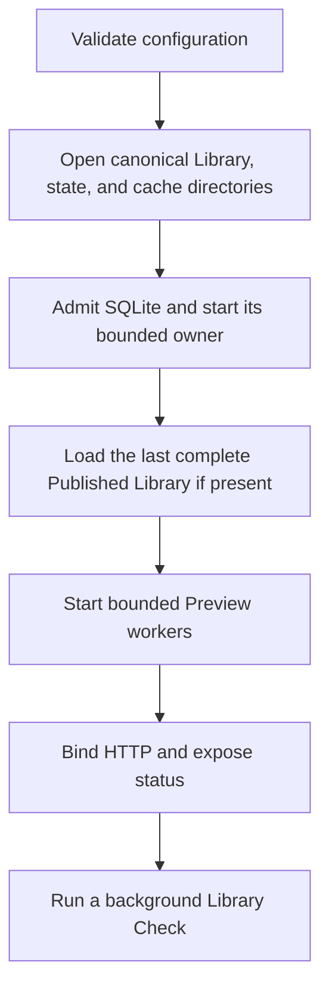

# Rust Server Architecture

The production server is a Rust modular monolith. Bun and TypeScript own the Web application, browser tests, and repository tooling, not a production server runtime.

[Foundational Architecture](design.md) owns product-module responsibilities. This contract owns server resource boundaries and lifecycle.

## Ownership Model

| Boundary                | Ownership                                                                                                                           |
| ----------------------- | ----------------------------------------------------------------------------------------------------------------------------------- |
| Application and HTTP    | Configuration, listener admission, request limits, protocol mapping, static delivery, readiness, and shutdown.                      |
| Library and Confinement | The Library Folder descriptor, traversal, Original capabilities, identities, Locations, fingerprints, recovery, and revision facts. |
| Persistence             | One SQLite connection on one dedicated thread, with a bounded typed command queue and serialized durable mutations.                 |
| Preview and Native      | Confined JPEG reads and a narrow LibRaw/libjpeg boundary for embedded-JPEG inspection and validation.                               |
| Derivative and Cache    | Image normalization, scheduling, cache identity, atomic publication, stale fallback, and immutable delivery.                        |

Modules MUST exchange domain values and typed failures. HTTP types MUST NOT enter Persistence or Native boundaries.

Native error text and Library filesystem paths MUST NOT cross the protocol boundary. Authorized [Photo Workspace](photo-development/workspace/design.md) responses MAY expose their execution path and namespace without granting arbitrary server-path access.

Persistence MUST retain one bounded admission and shutdown owner. Sharing a typed reply path MUST NOT introduce a second queue or dynamic command dispatch.

Caller validation and concrete command construction remain outside reply-channel plumbing. Domain-specific mutation and metadata failures MUST retain their typed paths.

## Lifecycle

A new state store MUST remain initializing until its first complete Library publication. A failed startup MUST close acquired resources in reverse order.

| Surface           | Admission and result                                                                                                      |
| ----------------- | ------------------------------------------------------------------------------------------------------------------------- |
| `GET /healthz`    | After storage admission, Preview worker startup, and HTTP bind, return `200` with exactly `{"status":"ok"}` and no paths. |
| `GET /api/status` | Separately report Published Library availability and initialization, scanning, idle, or failed state.                     |
| Listener          | MUST remain unbound after Library binding, schema, sidecar, or storage-layout admission failure.                          |

Shutdown MUST follow this order:

1. Stop HTTP and new work admission.
2. Drain already accepted mutations.
3. Stop Preview publication and release Preview and Library resources.
4. Close SQLite and join its owner.
5. Complete the shared shutdown result.

Repeated shutdown requests MUST share one completion path.

### Persistence Admission

SQLite startup MUST accept the configured `DELETE` journal policy only from a sidecar-free state. A journal, WAL, or shared-memory sidecar requires a recovery outcome before SQLite is opened.

Refused startup MUST leave the database and all sidecars unchanged. Recovery uses an operator-controlled copy rather than startup checkpointing or rewriting state whose schema or Library binding can exist only in WAL.

Accepted writes MUST retain canonical schema validation and `foreign_keys=ON`. Each write uses one admitted `BEGIN IMMEDIATE` transaction.

### Blocking Work

SQLite and native image work MUST NOT run on asynchronous HTTP executor threads. Queue saturation MUST produce explicit backpressure rather than unbounded memory growth.

## Network Exposure

The default listener is loopback. [Instance Access](access/design.md) owns credential verification and admission before private handlers; missing access configuration MUST NOT create an anonymous fallback.

[Deployment](deployment/spec.md) owns HTTP or HTTPS exposure. Accounts and external identity providers are outside this server contract.

## Compatibility

| Boundary              | Preserved contract                                                                                                                                                     |
| --------------------- | ---------------------------------------------------------------------------------------------------------------------------------------------------------------------- |
| HTTP                  | Bounded routes and statuses, path-free JSON errors, and a 16 KiB decoded header limit.                                                                                 |
| Ordinary mutations    | A 64 KiB streamed body bound; capability-specific request limits remain owned by their contracts, including [Metadata](photo-library/metadata/design.md#api-boundary). |
| Private content       | Strong derivative ETags derived from cache identity, private delivery, revalidatable `index.html`, and no API-to-SPA fallback.                                         |
| Persistent identity   | Existing Original File and Photo IDs remain opaque and unchanged; new IDs are Location-independent and unique within the state store.                                  |
| Serialization         | Source revision and cache/manifest identity serialization preserve Unicode and fractional modification times.                                                          |
| Process configuration | Startup paths are absolute; failed startup cleans up resources; close is idempotent and signal-aware.                                                                  |

[Library Identity](photo-library/identity.md#persistence-and-cache-semantics) owns admitted schema versions, migration preservation, and ancestor expansion. Older binaries MUST reject newer writable state rather than partially interpret it.

Deployment MUST preserve bind-mounted state and cache. The CLI remains a service client without direct persistence or native Preview ownership.

[Preview Pipeline](photo-library/previews/design.md) owns source isolation, native resource limits, revision validation, cache-version compatibility, and truthful stale delivery. Exact-content recovery and resumable fingerprint enrollment remain under [Photo Library](photo-library/spec.md).

[Compatibility fixtures](../compatibility/) own concrete JSON and SQL cases. They do not replace the owning product and design contracts.

An implementation improvement, such as broader valid `If-None-Match` parsing, MUST preserve accepted compatibility behavior. [Contributing](../CONTRIBUTING.md#verification) owns the verification gate rather than this contract.

## Selected Technology Direction

| Boundary               | Selected integration                                                               |
| ---------------------- | ---------------------------------------------------------------------------------- |
| HTTP and lifecycle     | Axum with Tokio, using service-owned runtime resources.                            |
| Persistence            | rusqlite with bundled SQLite and a single bounded owner thread.                    |
| Original access        | Linux `openat2` confinement and Rust-owned descriptors.                            |
| RAW Preview inspection | An owned C/C++ wrapper around LibRaw and libjpeg.                                  |
| Derivatives            | An owned C wrapper around libvips, with LittleCMS for explicit profile transforms. |

Dependency manifests and lockfiles own exact versions and feature selections. The single owner preserves transaction ordering without introducing a connection pool or generic migration framework.

### Native Boundary

The production native ABI MUST use:

- opaque handles;
- fixed-width values;
- owned byte buffers;
- normalized outcomes.

Rust MUST retain descriptor ownership. [Preview Pipeline](photo-library/previews/design.md#native-library-boundary) owns same-descriptor revision checks and the permitted native operations.

The derivative wrapper MUST own the libvips object graph and translate failures into bounded Rust outcomes. libvips objects and GLib ownership conventions MUST NOT escape into the rest of the service.

The wrapper exposes only:

- JPEG inspection;
- orientation normalization;
- bounded resize;
- profile handling;
- JPEG encoding.

The first Preview operation MUST initialize libvips once for the process. Requests, Libraries, and Preview services MUST NOT call `vips_shutdown`; initialization lasts until process exit.

The wrapper MUST use bounded libvips operation options. [Preview Pipeline](photo-library/previews/design.md#native-library-boundary) owns the queue concurrency and image-memory bounds.

The runtime MUST NOT depend on Sharp or Node. Native Preview extraction MUST NOT become a RAW development interface.

## Photo Development Processes

The service retains Photo, protocol, workspace-index, and supervised-run ownership. Independent tools own canonical on-disk Edit State and native child lifetime.

[Photo Development](photo-development/design.md) owns supervised use of those tools inside the application container. Standalone tools MUST NOT depend on the service or become additional HTTP or Library owners.
